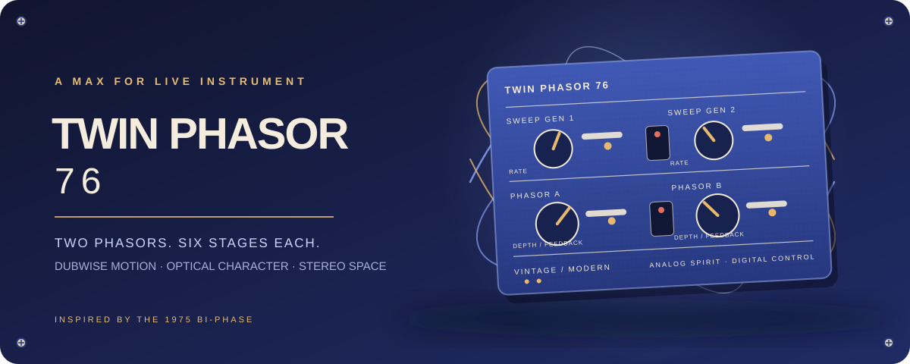
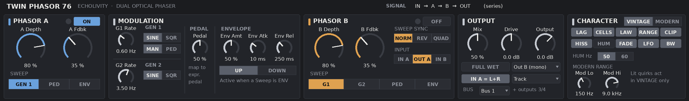
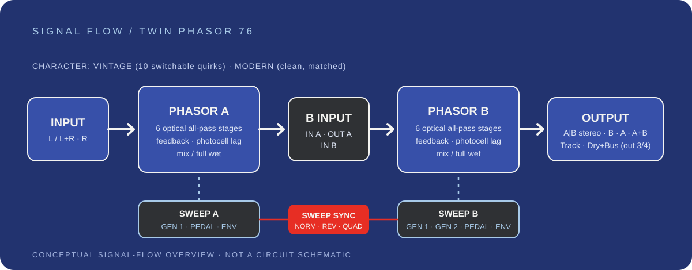
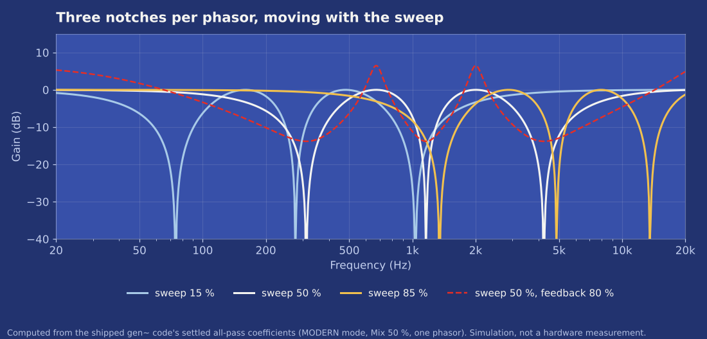
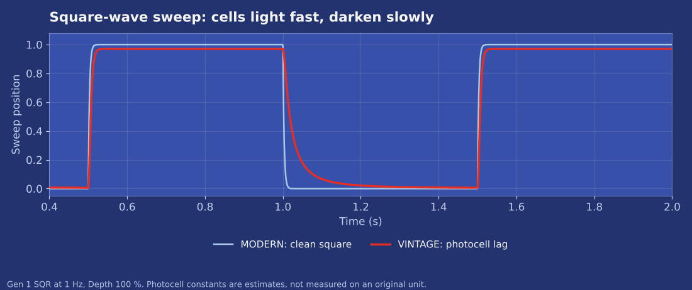
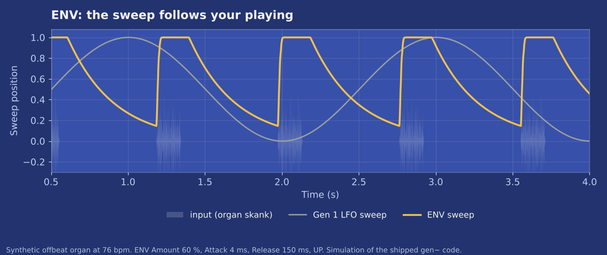

<div align="center">
  
  <h1>TWIN PHASOR 76</h1>
  <p><strong>A dual optical phasor for Ableton Live.</strong></p>
  <p>
    Six stages. Two phasors. One beautifully unstable stereo field.
  </p>
  <p>
    <em>Inspired by the 1975 Bi-Phase and the dub experiments of the Black Ark.</em>
  </p>
</div>

---

## The sound of movement

Twin Phasor 76 is a dual six-stage optical phasor modelled on the 1975 Bi-Phase circuit associated with Lee “Scratch” Perry's Black Ark sound.

It brings the character of that classic machine into Max for Live, while keeping the original's quirks optional. Switch to **MODERN** for a clean, matched response; switch to **VINTAGE** to bring the character back in.

> **Release candidate S4 · Conditional**
>
> Confirmed to load in Ableton Live 12.4.15 with Max 9.1.5 on Windows (17 November 2026). Offline build and DSP tests pass. Remaining Live routing, automation and listening checks are tracked in [`docs/OWNER_TESTS.md`](docs/OWNER_TESTS.md).

## At a glance

| | |
|:--|:--|
| **Format** | Max for Live audio effect |
| **Architecture** | Dual six-stage optical phasor |
| **Modulation** | Two LFOs, pedal control and envelope follower |
| **Character** | VINTAGE quirks or clean MODERN mode |
| **Output** | Stereo, mono and separate processed bus |
| **Control** | Live parameters, MIDI mapping, key mapping and Push banks |

## Inside the sound



<sub>Static layout render from the build script: a design reference, not a screenshot from Live.</sub>





<sub>Each phasor carves three notches that move together with the sweep. Feedback turns the gaps between them into resonant peaks.</sub>



<sub>In VINTAGE, the modelled photocells light quickly and darken slowly, so a square sweep snaps and then slides.</sub>



<sub>With ENV, each offbeat chord pushes the sweep up and the release lets it fall back, while an LFO drifts on its own.</sub>

<sub>The plots are generated from the shipped gen~ code by `tools/make_readme_plots.py`. They are simulations, not hardware measurements.</sub>

## Install

1. Copy `Twin Phasor 76.amxd` into your Live User Library, for example:
   `User Library/Presets/Audio Effects/Max Audio Effect/`
2. Drop **Twin Phasor 76** onto an audio track.
3. Optionally install `Twin Phasor Return.amxd` if you need the legacy send/return workflow.

If Live refuses the `.amxd`, open the matching `.maxpat` in Max and save it as a Max Audio Effect.

## The controls

### Two sweep generators

Each generator offers a **0.1–18 Hz** rate and SINE or SQR shape. Gen 1 can follow the pedal in PED mode.

### Two phasors

Each phasor has Depth, Feedback, a selectable sweep source and an illuminated on/off switch.

| Control | Sources / modes |
|---|---|
| **Phasor A sweep** | GEN 1 · PED · ENV |
| **Phasor B sweep** | G1 · G2 · PED · ENV |
| **B sync** | NORM · REV · QUAD |
| **B input** | IN A · OUT A · IN B |

**QUAD** places B a quarter-cycle (90°) ahead of A when both follow Gen 1, creating a rotating stereo movement. It is an added mode, not part of the original unit.

### Envelope follower

The envelope follower turns input level into sweep movement. It is an added feature, not part of the original unit.

- **Amount:** sensitivity. At 100%, a −12 dBFS peak reaches full sweep.
- **Attack:** 1–100 ms.
- **Release:** 20–2000 ms.
- **UP / DOWN:** choose whether louder input opens the sweep upward or drives it downward.
- **Depth:** limits the sweep range, just as it does for LFO and pedal modulation.

In VINTAGE mode, photocell lag also smooths the envelope response.

### Pedal

PEDAL is a manual sweep position, standing in for the original C-100 pedal. Map it to an expression pedal or Live macro for hands-on sweeps. It operates within the Depth range, so Depth at zero means no movement.

### Output and routing

- **Mix:** 50% is the original's fixed blend.
- **FULL WET:** removes the dry signal.
- **Drive / Output:** shape and control the output level.
- **Out Mode:** Out A | Out B stereo, Out B mono, Out A mono, or A + B mono.
- **IN A:** choose L or L+R.
- **Route:** Track, Dry + Bus, or Bus only.

To send the processed signal to another Live track:

1. Set **Route** to **Dry + Bus** (or **Bus only**).
2. On another audio track, set **Audio From** to the phasor track.
3. Select **Twin Phasor 76 | 3/4** in the lower chooser.
4. Set Monitor to **In**.

This uses Live's own delay-compensated routing. The legacy **Twin Phasor Return** uses `send~` / `receive~`; Cycling '74 does not support that between devices, and its latency varies with buffer size. Prefer outputs 3/4 when available.

## Play it

### Black Ark wash
`B Input: OUT A` · `Out Mode: Out B (mono)` · Both phasors on Gen 1 · `NORM` · Feedback 0

### Stereo swirl
`B Input: IN A` · `Out Mode: Out A|B` · Both on Gen 1 · `REV` for opposite movement or `QUAD` for rotation · Feedback around 60–80

### A skank that reacts
`A Sweep: ENV` · `UP` · Amount around 60% · Attack 4 ms · Release 150 ms · Feedback around 50

### Two speeds at once
Put A on slow Gen 1 at full Depth and Feedback. Put B on faster Gen 2 at 50% Depth.

## MIDI, automation and Push

Every control is a standard Live parameter.

- **MIDI Map:** `Ctrl+M` (Mac: `Cmd+M`), select a control, move a controller, then exit MIDI Map mode.
- **Key Map:** `Ctrl+K` for keyboard assignments.
- **Macros and automation:** all 42 controls are available to Live automation and Rack macros.
- **Expression pedal:** map it to **Pedal** for wah-style sweeps.

### Push banks

| Bank | Controls |
|---|---|
| 1 · Perform | A Depth, A Feedback, B Depth, B Feedback, Gen 1 Rate, Gen 2 Rate, Pedal, Mix |
| 2 · Switch | A On, B On, Full Wet, A Sweep, B Sweep, B Sync, B Input, Character |
| 3 · Envelope | Env Amount / Attack / Release / Polarity, generator shapes and sources, Drive |
| 4 · Output | Output, Out Mode, In A Sum, Route, Bus, Modern Lo / Hi, Hum Freq |
| 5–6 · Quirks | The ten CHARACTER switches |

The device is an audio effect; it does not receive MIDI directly.

## Vintage character, modern control

The panel colours take their cue from photographs of the original hardware: deep face blue, white legends and outlines, and charcoal switch blocks. The switch colours distinguish the original-style control groups.

**VINTAGE** enables the selectable character quirks. **MODERN** disables them and sweeps cleanly between Modern Lo and Modern Hi.

## Mind the level

Feedback is stable at every setting (loop gain ≤ 0.862), but it adds gain. With one phasor at full feedback, peaks can reach about **+12 dB** (**+17 dB** with FULL WET). Two phasors in series can reach about **+25 dB**.

In VINTAGE mode, CLIP models the original op-amp saturation. In MODERN mode, nothing limits the level: use Output or Drive to manage it.

## Build and test

```bash
pip install -r requirements.txt
python3 src/build_device.py
python3 tests/run_tests.py
node tests/render_auditions.js out/
```

- `m4l-builder==0.7.0`
- Test runner requires Node.js 18 or newer.
- `src/build_device.py` rebuilds both devices.
- `tests/run_tests.py` runs the static and DSP suites.
- `tests/render_auditions.js` renders the A/B audition WAVs.

## Validation and limitations

The automated suites run the shipped gen~ code through an offline translation and check the device files statically. **49 of 49 tests pass**, covering:
- stability and finite output;
- notch positions;
- clicks on switching and under fast automation;
- denormals;
- parameter ranges;
- routing;
- preset compatibility;
- reproducible builds.

This is simulation, not native Live testing. In Live, loading is confirmed and the remaining checks are in progress.

Known limitations:
- Photocell constants are estimates, not measured on an original unit.
- No comparison against real hardware has been made.
- ENV listens to the device input; there's no sidechain.
- The legacy Return device relies on unsupported `send~`/`receive~`.

Twin Phasor 76 is a **circuit-informed model, not a hardware clone**. It is not affiliated with or endorsed by Musitronics, Mu-Tron, or the estate of Lee "Scratch" Perry; those names are used only to describe the historical reference.

For implementation details and project status, see [`ENGINEERING.md`](ENGINEERING.md), [`docs/SPRINT_REPORT.md`](docs/SPRINT_REPORT.md), [`docs/OWNER_TESTS.md`](docs/OWNER_TESTS.md), and [`CHANGELOG.md`](CHANGELOG.md).

---

<div align="center">
  <sub>Built for deep modulation, dubwise space and curious ears.</sub>
</div>
