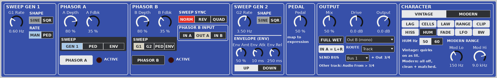
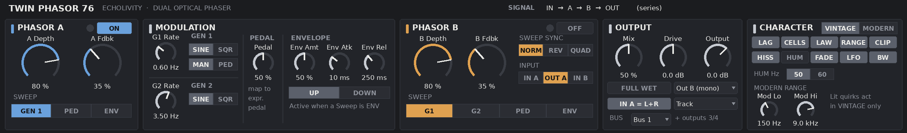
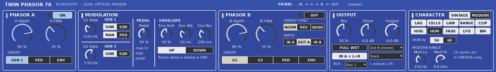

# Twin Phasor 76 interface (redesign, 2026-11-18)

**Status: built and statically validated; not yet loaded in Ableton Live.** Everything below is checked by the automated suites except where marked **UNVERIFIED (needs Live)**.

Before (S4)

After: graphite (default)

After: classic theme (`python3 src/build_device.py --theme classic`), the Bi-Phase colours in the new layout

These images are approximate renders from the build data (`tests/preview_layout.py`), not screenshots from Live. Live draws its own knobs and type, so expect small differences in arc shape, font and spacing.

## Layout

| Area | What's there |
|---|---|
| Header | Name and identity; **SIGNAL** readout that follows B Input (parallel / series / separate) |
| Phasor A (blue) | On/off with sweep lamp, Depth and Feedback (large), Sweep source |
| Modulation (neutral) | Gen 1 (Rate, Shape, Rate source), Gen 2 (Rate, Shape), Pedal, Envelope (Amount, Attack, Release, UP/DOWN) |
| Phasor B (amber) | On/off with sweep lamp, Depth and Feedback (large), Sweep Sync, Input, Sweep source |
| Output (neutral) | Mix, Drive, Output, FULL WET, Out Mode, In A source, Route, legacy Bus |
| Character (neutral) | VINTAGE / MODERN, ten quirk switches, Hum Hz, Modern Lo/Hi |

## Design system

| Token | Graphite | Use |
|---|---|---|
| Body | `#1b1c1f` | Device background |
| Section | `#232529`, line `#2e3136` | Section panels |
| Ink / secondary ink | `#ebebe8` / `#8e939b` | Values and names / labels and off states |
| Control | `#2b2e33`, line `#3a3e45` | Switch and menu bodies |
| Phasor A | `#6aa2dc` | Arcs, lit switches, lamp in Phasor A only |
| Phasor B | `#e0a250` | The same in Phasor B only |
| Neutral on | `#5b616b` with light text | Lit shared switches (modulation, output, character) |
| Arc track | `#3a3d43` | Unlit part of every dial arc |

Accent colour appears only where it means something: which phasor a control belongs to. Shared controls stay neutral.

**Not relying on colour alone:**
- Lit switches change fill brightness *and* text brightness.
- A and B are also named in every section title and dial name.
- The on/off buttons read OFF / ON.

Type is Ableton Sans Medium for values and Ableton Sans Bold for titles and switches, at 8–11 pt. Major controls (A/B Depth and Feedback) are about twice the size of secondary dials.

## Interaction

All controls are native Live controls (`live.dial`, `live.tab`, `live.text`, `live.menu`), so they behave like Live's own devices:
- drag to change, Shift-drag for fine adjustment;
- select and press Delete to return to the default;
- automation, MIDI Map (Ctrl/Cmd+M), Key Map, macros and Push all work as before.

Each control has a description in Live's **Info View** (bottom-left of Live; hover over a control). The phasor lamps follow the modelled light level at about 30 frames a second.

## What the brief asked for that this device cannot or does not do

| Requested | Status |
|---|---|
| Compact / standard / expanded window sizes | **Not possible.** Max for Live devices have a fixed 169 px height and a width fixed at design time, and there's no user resizing. One layout at 1132 px is provided. Live's own device fold collapses it. |
| Preset selector and save/load in the header | **Not added.** Live's preset system (the device's save icon and the browser) stores all 42 parameters. A second in-device system would duplicate it. |
| Global bypass control | **Live's own device switch** (top-left of the device title bar). Phasor A/B have their own on/off. |
| Per-phasor Rate | Rates belong to the sweep generators: Gen 1 drives A (and B when B Sweep = G1); Gen 2 drives B. Shown under Modulation. |
| Per-phasor Mix, per-phasor stereo controls | **Not implemented in the DSP.** Mix is global. Not added as fake controls. |
| Tempo sync / note divisions | **Not implemented in the DSP.** Not added as fake controls. |
| Hover states, custom tooltip popups, monospaced numerals, double-click reset | Native Live controls provide focus highlighting and Info View text. Live draws value text in its own font, and reset is Delete, not double-click. A custom-drawn UI (jsui) could add these, but it would also add CPU load and a new load-crash risk. |
| Animated signal-flow diagram | The header readout shows the active B Input routing as text. A drawn diagram would need jsui; not done for the same reason. |

## Validation

Automated (`python3 tests/run_tests.py`): **54 / 54 pass**.

| Check | Result |
|---|---|
| B14 parameter contract vs S4: names, ranges, defaults, options, units, curves, object IDs, order (45 parameters, both devices) | PASS. One approved display-only change: A On / B On read OFF/ON instead of "PHASOR A". The stored values are identical. |
| B15 every control visible, inside 169 px, in front of decoration, no overlaps | PASS |
| B16 routing readout follows all three B Input values | PASS |
| B1/B7 DSP (gen~ code) unchanged | PASS (0 lines differ from main) |
| B8/B9 every control drives its gen~ parameter with the right range | PASS |
| B2 reproducible build | PASS |
| DSP suite (stability, clicks, routing, presets…) | 31 / 31 PASS |

**UNVERIFIED (needs Live):** that both devices load; how the controls and fonts look in Live; Info View text; the routing readout switching live; that automation and presets saved with S4 recall into this build; Push display; CPU. The 15-minute owner test in [`OWNER_TESTS.md`](OWNER_TESTS.md) covers these. Also run **L11**: open a set saved with S4 and check that every value comes back.

Full mapping: [`UI_MAPPING.md`](UI_MAPPING.md).

## Modified files

`src/build_device.py`, `src/param_ids_s4.json` (new), `Twin Phasor 76.amxd/.maxpat`, `Twin Phasor Return.amxd/.maxpat`, `tests/test_build.py`, `tests/preview_layout.py`, `tests/fixtures/parameter_contract_s4.json` (new), `tools/make_ui_mapping.py` (new), `docs/UI.md`, `docs/UI_MAPPING.md`, `docs/img/ui/*` (new), `docs/panel_layout_preview.png`, `CHANGELOG.md`, `README.md`.
